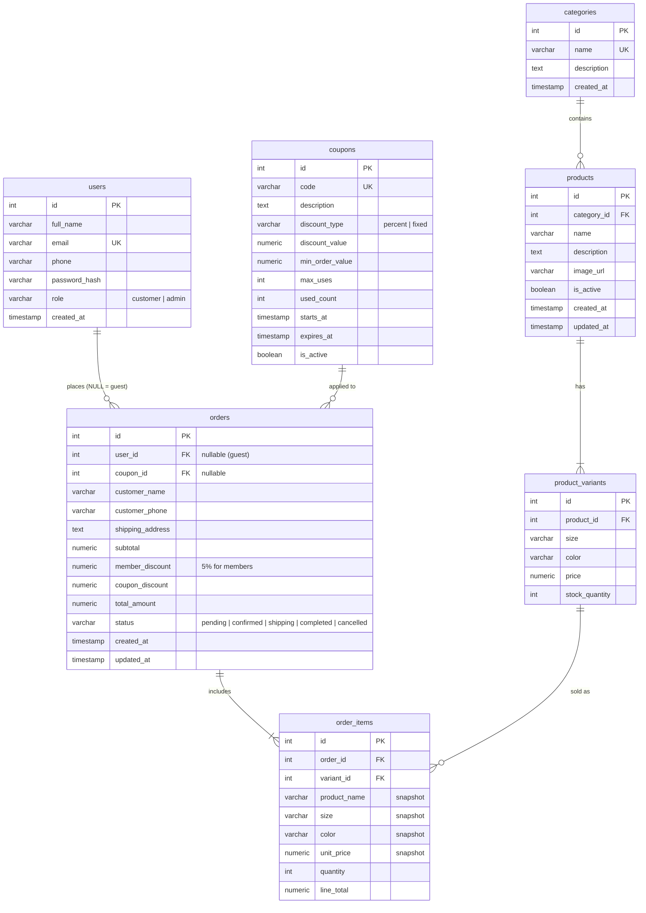

# StylishFashion – Entity Relationship Diagram (Checkpoint 02)

## Relationships

| Relationship | Cardinality | Notes |
|---|---|---|
| categories → products | 1 : N | A category cannot be deleted while it still has products (`ON DELETE RESTRICT`). |
| products → product_variants | 1 : N | Each product has one or more size/color variants. Variants are deleted with the product (`ON DELETE CASCADE`). |
| users → orders | 1 : N (optional) | `orders.user_id` is `NULL` for guest checkout. |
| orders → order_items | 1 : N | Items are deleted with the order (`ON DELETE CASCADE`). |
| product_variants → order_items | 1 : N | A variant that has been ordered cannot be hard-deleted (`ON DELETE RESTRICT`). |
| coupons → orders | 1 : N (optional) | `orders.coupon_id` is `NULL` when no coupon is used. |

## Design Rules & Team Conventions

- **Guest vs. member:** `orders.user_id = NULL` means guest checkout and `member_discount = 0`. For registered members, `member_discount = ROUND(subtotal * 0.05)`.
- **Price snapshots:** `order_items` stores product name, size, color and unit price at purchase time, so order history stays correct when products are edited later.
- **Variant uniqueness:** `UNIQUE (product_id, size, color)` prevents duplicate variants.
- **Stock integrity:** `stock_quantity >= 0` is enforced by a `CHECK` constraint.
- **Checkout transaction:** lock the variants with `SELECT ... FOR UPDATE`, reduce `stock_quantity`, then insert into `orders` and `order_items` in a single transaction. Roll back if any step fails.
- **Order cancellation:** cancelling an order restores the ordered quantities to `stock_quantity` (done in one transaction).
- **Soft delete:** a product that already appears in orders is hidden with `is_active = FALSE` instead of being deleted.
- **Currency:** VND, stored as `NUMERIC(12,0)`.
- **JWT payload:** `{ id, role }`, signed with `JWT_SECRET`.
- **Sample accounts:** `admin@stylishfashion.vn / Admin@123` (admin), `an.nguyen@example.com / Customer@123` (customer).